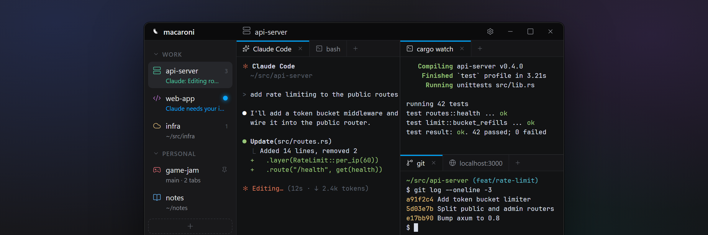
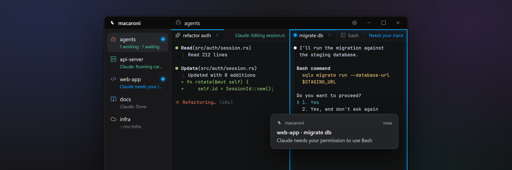
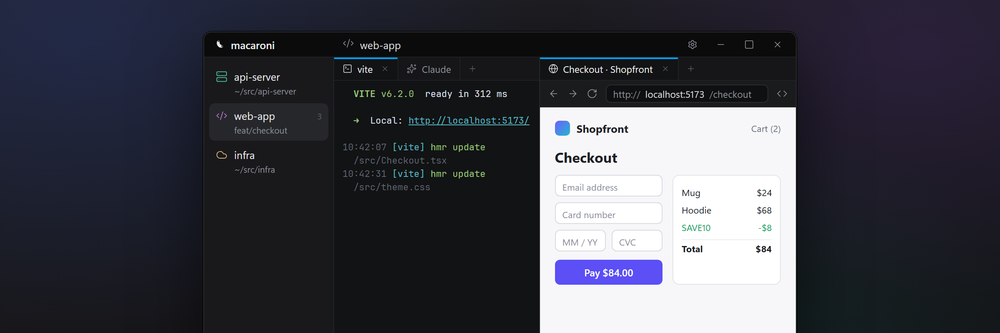
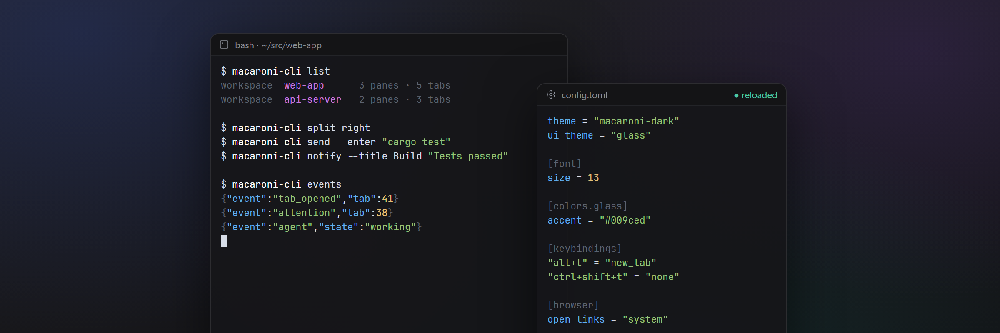

<p align="center"></p>

# macaroni

A native, GPU-rendered terminal for Windows and macOS, built for working alongside coding agents. I'm a big fan of [cmux](https://cmux.com/) on Mac, but haven't found an alternative for Windows that I really like.

I work on many projects at once, and want them split into workspaces, and to allow for **AS MANY PANELS**, and **AS MANY TABS** within each panel. I'm a big fan of various forms of tabs as well, such as VSCode and Chrome tabs.

This terminal seeks to provide that. Run your agent, dev server, code and browser all in one spot.

> macaroni is an early alpha (0.1.0-alpha.2): expect rough edges, and settings and the control API may still change.

- **Native and fast.** Rust on the GPU, not a web view, so it keeps up with whatever your agents print.
- **Made for agents.** Claude Code's live state shows in every pane and in the sidebar, and you get a ping the moment one needs you.
- **Every project in one place.** Workspaces, splits and tabs, all saved and restored, agents included.
- **Yours to shape.** Scriptable from the shell and configurable down to the last pixel.

## Features

<p align="center"></p>

- **Workspaces** in a vertical sidebar, with groups, pins, icons, colors and drag-and-drop.
- **Split panes with tabs in every pane.** Drag a tab to another pane, or onto an edge to split it.
- **Agent attention.** OSC 9, 777 and 99 light up the waiting tab, pane and workspace, then send an OS notification if you can't see it.
- **Claude Code integration.** One command adds hooks and a status line; sessions resume in the same tab after a restart.

<p align="center"></p>

- **Browser tabs.** The system's web view (Edge on Windows, Safari's engine on macOS) with an address bar and developer tools, or Chromium on Windows, an optional download in Settings. Ctrl+click (Cmd+click on macOS) a terminal link to open it in a split.
- **VS Code tabs** (Windows, opt-in). Download VS Code for the web from settings and open it in a tab at the pane's folder.

<p align="center"></p>

- **Scriptable.** `macaroni-cli` lists, splits, types, reads, notifies and streams events over a local socket.
- **Configurable everything.** One live-reloading `config.toml` with a settings dialog over it: themes, a glass look, colors, sizes and every shortcut.
- **Session restore.** Layout, directories and agent sessions come back after a restart.
- **Good shells by default.** Your login shell on macOS, Git Bash on Windows (with PowerShell as a fallback and a one-click install).
- **SSH profiles.** Save hosts once and open them from the new-tab menu; a dropped connection reconnects with Enter.

## Get started

Download the zip for your platform from [Releases](https://github.com/andyruwruw/macaroni-terminal/releases). On Windows, unzip the `macaroni` folder anywhere and run `macaroni.exe`. On macOS, move `macaroni.app` to Applications. The builds aren't signed yet, so the first launch needs a click past a warning: on Windows choose More info > Run anyway; on macOS open it, then allow it in System Settings > Privacy & Security.

Or build and install from source, which needs [rustup](https://rustup.rs) plus the platform build tools (see [CONTRIBUTING.md](CONTRIBUTING.md#setup)):

```sh
./install              # build, install, start; run again to update
./install --uninstall  # remove the app (settings are kept)
```

The same command works in macOS's Terminal and in PowerShell, cmd or Git Bash on Windows (`.\install` in PowerShell and cmd). It installs to `/Applications` on macOS, or `%LOCALAPPDATA%\Programs\macaroni` with a Start menu shortcut on Windows.

Then hook up Claude Code from Settings > Integrations > Agents, or with:

```sh
macaroni-cli setup claude
```

It shows the change to `~/.claude/settings.json` and asks first; `--remove` undoes it.

## Keyboard Shortcuts

| | Windows | macOS |
|---|---|---|
| Split right / down | Ctrl+Shift+D / Ctrl+Shift+E | Cmd+D / Cmd+Shift+D |
| New tab / close tab | Ctrl+Shift+T / Ctrl+Shift+W | Cmd+T / Cmd+W |
| New workspace, switch | Ctrl+Shift+N, Ctrl+Shift+1..9 | Cmd+N, Cmd+1..9 |
| Move focus | Ctrl+Alt+arrows | Cmd+Alt+arrows |
| Find | Ctrl+F | Cmd+F |
| Toggle sidebar | Ctrl+B | Cmd+B |
| Settings | Ctrl+, | Cmd+, |

Every shortcut can be changed. Settings live in `%APPDATA%\macaroni\config.toml` (Windows) or `~/.config/macaroni/config.toml` (macOS), created on first run with every option documented.

## Scripting

```sh
macaroni-cli split right                # new pane next to this one
macaroni-cli send --enter "cargo test"  # type into a tab
macaroni-cli notify --title Agent "Waiting for input"
macaroni-cli events                     # stream events as JSON lines
```

Inside a macaroni terminal, commands act on their own tab, so `macaroni-cli notify` is a one-line agent hook.

## Contributing

See [CONTRIBUTING.md](CONTRIBUTING.md) for setup, the dev loop and the checks, and [`references/`](references/) for how each part works. Changes are recorded in [CHANGELOG.md](CHANGELOG.md).

## License

[MIT](LICENSE). Bundled fonts, icons and ConPTY, and the optional Chromium download, keep their own licenses.
