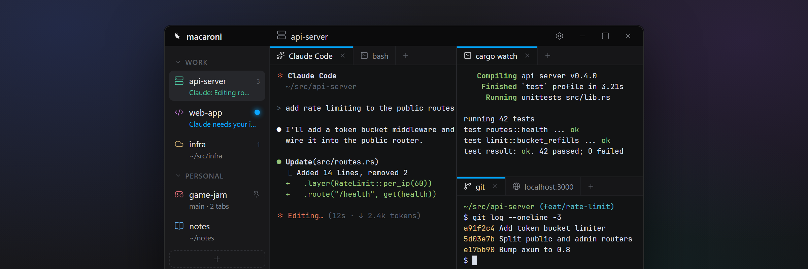
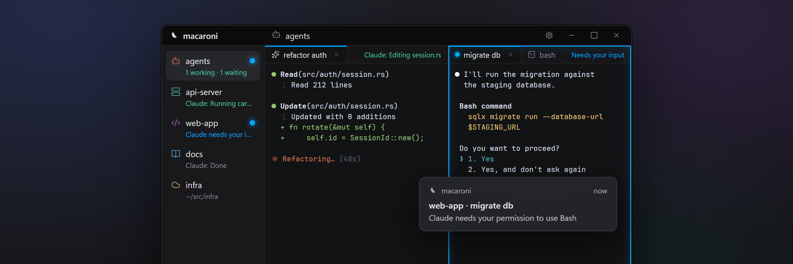
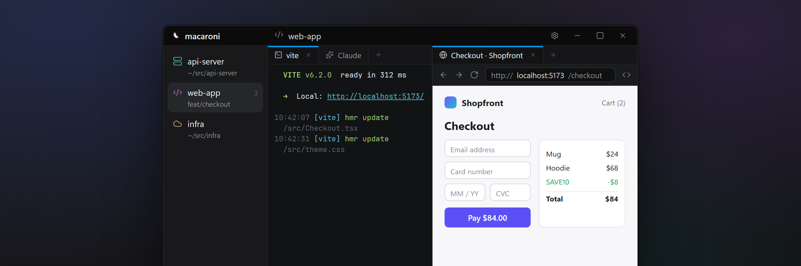
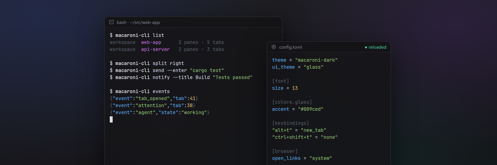

<p align="center"></p>

# macaroni

A native, GPU-rendered terminal for Windows and macOS, built for working alongside coding agents. I'm a big fan of [cmux](https://cmux.com/) on Mac, but haven't found an alternative for Windows that I really like.

I work on many projects at once, and want them split into workspaces, and to allow for **AS MANY PANELS**, and **AS MANY TABS** within each panel. I'm a big fan of various forms of tabs as well, such as VSCode and Chrome tabs.

This terminal seeks to provide that. Run your agent, dev server, code and browser all in one spot.

> macaroni is an early alpha (0.1.0-alpha.3): expect rough edges, and settings and the control API may still change.

- **Native and fast.** Rust on the GPU, not a web view, so it keeps up with whatever your agents print.
- **Made for agents.** Claude Code's live state shows in every pane and in the sidebar, and you get a ping the moment one needs you.
- **Every project in one place.** Workspaces, splits and tabs, all saved and restored, agents included.
- **Yours to shape.** Scriptable from the shell and configurable down to the last pixel.

## Features

<p align="center"></p>

- **Workspaces** in a vertical sidebar, with groups, pins, icons, colors and drag-and-drop, in as many windows as you like.
- **Split panes with tabs in every pane.** Drag a tab to another pane, or onto an edge to split it.
- **Agent attention.** OSC 9, 777 and 99 light up the waiting tab, pane and workspace, then send an OS notification if you can't see it.
- **Claude Code and Codex integration.** One command each connects them; sessions resume in the same tab after a restart.
- **Panel plugins.** Drop a small script in the `plugins` folder and it adds rows above or below the panels it's for, fed the panel's agent, session and transcript. A built-in one shows whether an agent's prompt cache is still warm.

<p align="center"></p>

- **Browser tabs.** The system's web view (Edge on Windows, Safari's engine on macOS) with an address bar and developer tools, or Chromium on Windows, an optional download in Settings. Ctrl+click (Cmd+click on macOS) a terminal link to open it in a split.
- **Git tabs.** A repository's changes and history in a tab, in the manner of GitHub Desktop: check files into a commit, read every diff, switch or create branches, and fetch, pull, push or publish.
- **Agent setup tabs.** Claude Code's and Codex's setup, yours and the project's, in one place: instructions, settings, skills, subagents, commands, hooks and MCP servers, each with its text and a button to open it. Your `.claude` and `.codex` folders open as a workspace or a terminal in one click.
- **File tabs.** Show a file beside your terminals: code highlighted, Markdown rendered with its images, pictures and SVGs drawn, videos and sounds played. Its name lists the folder's other files, arrows at the bottom step through them, and a folder tree of the repository can sit beside it. It follows changes as an agent writes it. Open one from the new-tab menu, with `macaroni-cli open README.md`, or by Ctrl+clicking (Cmd+clicking) a file named in a terminal; Ctrl+right-click it to open it in a VS Code tab or another app instead, and pick the default in Settings > Files. Download viewers there too to draw Mermaid, math, Graphviz, PlantUML and D2 in Markdown and in their own files.
- **VS Code tabs** (Windows, opt-in). Download VS Code for the web from settings and open it in a tab at the pane's folder.

<p align="center"></p>

- **Scriptable.** `macaroni-cli` lists, splits, types, reads, notifies and streams events over a local socket.
- **Configurable everything.** One live-reloading `config.toml` with a settings dialog over it: themes, a glass look, colors, sizes and every shortcut.
- **Session restore.** Layout, directories, scrollback and agent sessions come back after a restart, and closed tabs reopen with Ctrl+Shift+R.
- **Command history.** Every workspace remembers the commands run in each of its panes, most used first, to find by typing and run again (Ctrl+Shift+K, Cmd+Shift+K).
- **Triggers and inline images.** Regex rules on output highlight, notify or badge a tab; programs can show pictures inline (iTerm2's OSC 1337, as `imgcat` sends).
- **Good shells by default.** Your login shell on macOS, Git Bash on Windows (with PowerShell as a fallback and a one-click install).
- **Built-in SSH.** Save hosts once and open them from the new-tab menu. macaroni's own client reads `~/.ssh/config` (ProxyJump included), uses your SSH agent and keys, asks for passwords and new host keys right in the tab, and opens more tabs to the same host on the one connection. A dropped connection reconnects with Enter.
- **Accessible.** Screen readers (Narrator, NVDA, VoiceOver) hear the sidebar, tabs, menus, settings and each terminal's text, with new output read out as it arrives. F6 and the arrow keys reach everything without a mouse. A whole-window size, high contrast, a minimum text contrast and reduced motion, following your system's settings where it has them.
- **tmux integration.** Run `tmux -CC` (or give a profile `tmux = "main"`) and the session's windows open as tabs, their panes drawn natively with macaroni's scrollback, find and selection. Splits and new tabs there go to tmux; the session keeps running when you detach (Esc) or lose the connection.

## Get started

Download the zip for your platform from [Releases](https://github.com/andyruwruw/macaroni-terminal/releases). On Windows, unzip the `macaroni` folder anywhere and run `macaroni.exe`. On macOS, move `macaroni.app` to Applications. The builds aren't signed yet, so the first launch needs a click past a warning: on Windows choose More info > Run anyway; on macOS open it, then allow it in System Settings > Privacy & Security.

Or build and install from source, which needs [rustup](https://rustup.rs) plus the platform build tools (see [CONTRIBUTING.md](CONTRIBUTING.md#setup)):

```sh
./install              # build, install, start; run again to update
./install --uninstall  # remove the app (settings are kept)
```

The same command works in macOS's Terminal and in PowerShell, cmd or Git Bash on Windows (`.\install` in PowerShell and cmd). It installs to `/Applications` on macOS, or `%LOCALAPPDATA%\Programs\macaroni` with a Start menu shortcut on Windows.

Then hook up Claude Code and Codex from Settings > Integrations > Agents, or with:

```sh
macaroni-cli setup claude
macaroni-cli setup codex
```

Each shows the change to `~/.claude/settings.json` or `~/.codex/config.toml` and asks first; `--remove` undoes it.

## Plugins

A plugin adds rows to the top or bottom of panels. Make a folder for it in `plugins` next to `config.toml` (`%APPDATA%\macaroni` on Windows, `~/.config/macaroni` on macOS) with a `plugin.toml`:

```toml
name = "Agent session"
command = ["python", "session.py"]   # or one line for the shell: "python session.py"
agents = ["any"]                     # only panels running an agent ("claude", "codex")
position = "top"                     # or "bottom"
interval = 10                        # seconds between runs
```

macaroni runs the command in that folder with the panel's details as JSON on stdin (its tab, folder, and agent with its session id and transcript path) and shows each line it prints, ANSI colors included:

```python
import json, sys
agent = json.load(sys.stdin)["agent"]
print(f"\x1b[2m{agent['kind']} session {agent['session_id']}\x1b[0m")
```

Turn a plugin on or off for one panel from its tab's menu (Plugins), or everywhere with `[plugins.<folder name>] on = false` in `config.toml`, where other keys become settings the plugin reads. The built-in `cache` plugin shows whether an agent's prompt cache is still warm.

## Keyboard Shortcuts

| | Windows | macOS |
|---|---|---|
| Split right / down | Ctrl+Shift+D / Ctrl+Shift+E | Cmd+D / Cmd+Shift+D |
| New tab / close tab | Ctrl+Shift+T / Ctrl+Shift+W | Cmd+T / Cmd+W |
| New workspace, switch | Ctrl+Shift+N, Ctrl+Shift+1..9 | Cmd+N, Cmd+1..9 |
| New window | Ctrl+Alt+Shift+N | Cmd+Shift+N |
| Move focus | Ctrl+Alt+arrows | Cmd+Alt+arrows |
| Find, search every tab | Ctrl+F, Ctrl+Shift+G | Cmd+F, Cmd+Option+F |
| Command history | Ctrl+Shift+K | Cmd+Shift+K |
| Command palette | Ctrl+Shift+P | Cmd+Shift+P |
| Jump to a pane by letter | Ctrl+Shift+J | Cmd+Shift+J |
| Git tab | Ctrl+Shift+H | Cmd+Shift+H |
| Toggle sidebar | Ctrl+B | Cmd+B |
| Keyboard to the tab strip, then the sidebar | F6 | F6 |
| Settings | Ctrl+, | Cmd+, |

Every shortcut can be changed. Settings live in `%APPDATA%\macaroni\config.toml` (Windows) or `~/.config/macaroni/config.toml` (macOS), created on first run with every option documented.

## Scripting

```sh
macaroni-cli split right                # new pane next to this one
macaroni-cli send --enter "cargo test"  # type into a tab
macaroni-cli notify --title Agent "Waiting for input"
macaroni-cli open README.md             # show a file in a tab
macaroni-cli events                     # stream events as JSON lines
```

Inside a macaroni terminal, commands act on their own tab, so `macaroni-cli notify` is a one-line agent hook.

## Contributing

See [CONTRIBUTING.md](CONTRIBUTING.md) for setup, the dev loop and the checks, and [`references/`](references/) for how each part works. Changes are recorded in [CHANGELOG.md](CHANGELOG.md).

## License

[MIT](LICENSE). Bundled fonts, icons and ConPTY, and the optional Chromium download, keep their own licenses.
